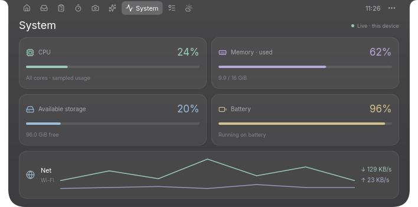
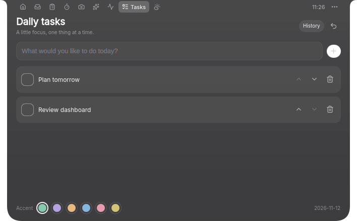
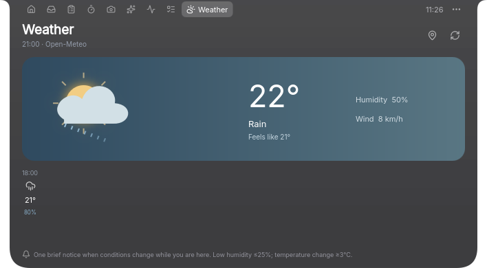
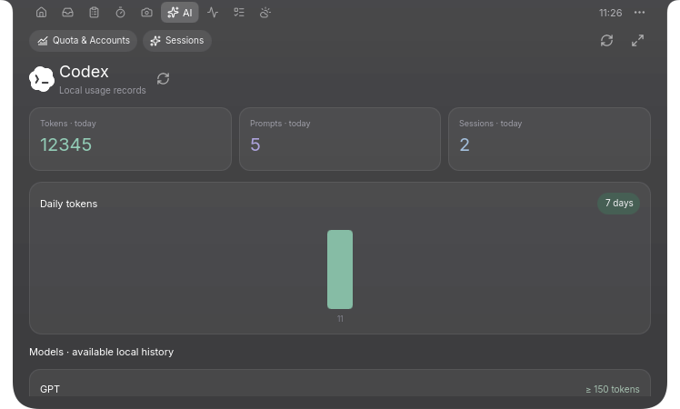
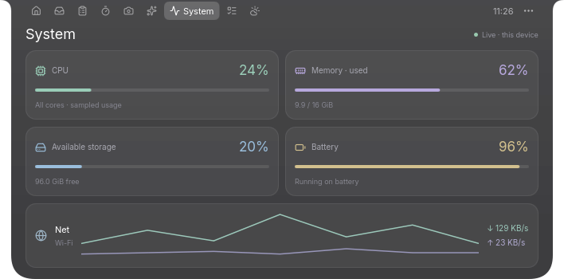

# Notchi for Omarchy

Ilha dinâmica nativa para o shell do Omarchy, inspirada em [OpenNotchi, de nannndev](https://github.com/nannndev/OpenNotchi). Adaptação independente para Linux/Wayland, em QML/Quickshell, sob licença MIT. A interface usa o código e as capturas oficiais como base para medidas, composição, vinil, calendário, navegação e nove perfis de animação. Logos de provedores vêm do repositório; os vetores Lucide vêm da mesma biblioteca da versão Windows. Os créditos e as licenças estão preservados. Third-party sources and licenses are listed in [THIRD_PARTY_NOTICES.md](THIRD_PARTY_NOTICES.md).



Screenshots below are captured from the real Qt interface with synthetic demo data.

| Daily tasks | Weather |
| --- | --- |
|  |  |
| AI details | System |
|  |  |

## Usar

- Passe o mouse sobre a ilha no centro da barra para abrir.
- **Super + Alt + N** abre ou fecha no monitor em foco. **Esc** fecha.
- O alfinete mantém o painel aberto; clicar fora fecha quando ele está fixado.
- **Ctrl + 1 … 8** troca as seções; as seções principais aparecem no topo.
- A roda do mouse sobre a ilha ajusta o volume.
- O menu **…** abre calendário, controles e ajustes. Nos ajustes, escolha o tema e uma das nove animações.

O Notch de IA anterior permanece ativo. Codex usa o nó verde GPT da referência e Claude usa o Clawd laranja. Os modelos 2D nativos usam somente olhos, sem boca ou sobrancelhas. Teclado com digitação, balão de pensamento, óculos/livro e lupa distinguem os estados. A geometria do nó deriva da referência; acessórios e movimentos foram implementados em QML. Desativar animações mantém uma pose estática. Arte comunitária de [Mascot for Agents](https://github.com/SaiTejaVoonna/mascot-for-agents), com licença/créditos incluídos.

Um novo período de trabalho detectado em Claude/Codex mostra um aviso discreto por cinco segundos na tela em foco, sem mover o foco ou abrir o painel inteiro. Clicar no aviso abre IA → Sessões. O painel novo lê os registros existentes de agentes do Omarchy, sem iniciar outra sessão de agente ou gerar cobranças de IA.

## O que está incluído

| Área | Disponível nesta versão |
| --- | --- |
| Aparência | Medidas e contorno do OpenNotchi, nove animações (seis 2D e três 3D), vidro com blur do Hyprland, preto e fosco; respeita as animações desligadas no Omarchy |
| Monitores | Uma ilha em cada tela; atalho abre no monitor em foco |
| Mídia | Fontes MPRIS, capa, vinil giratório, reproduzir/pausar, anterior/próxima, seek, shuffle/repeat quando o player expõe esses controles; volume e mute |
| Vídeo | Prévia ao vivo de uma janela escolhida; algumas janelas minimizadas não fornecem imagens ao compositor |
| Letras | Abrir Letras inicia a consulta ao LRCLIB; envia artista, título, álbum e duração. Trocas de faixa atualizam a letra somente enquanto a tela está aberta. Aceita letras sem sincronia e arquivos LRC |
| Agenda | Calendário, relógios de São Paulo/Londres/Dubai/Tóquio/Los Angeles, acesso ao calendário completo e ao globo originais |
| Reuniões | Acesso ao plugin existente de próximos eventos; o feed e sua configuração são preservados |
| Foco | Presets, duração e mensagem personalizadas; alerta entregue pelo systemd mesmo com o painel fechado ou recarregado |
| Arquivos | Soltar arquivos ou escolher pela janela de seleção; abrir, revelar, arrastar para fora, remover referência, OCR e conversão PNG/JPEG/WebP |
| Clipboard | Histórico já existente do Omarchy, busca e cópia de texto/imagens; sem instalar outro capturador de clipboard |
| Câmera | Prévia iniciada por botão, 18 estilos e quatro opções de moldura com seletores circulares e prévia ao vivo, fotos e desenho livre; originais preservados. Fecha o painel para desligar |
| Agentes | Cartões clicáveis com tokens de hoje, histórico diário e modelos quando reportados; cotas de uso consumido, atualizadas pelos coletores nativos a cada cinco minutos, horário/estado da leitura e atualização manual. Sessões Claude/Codex com atividade, projeto, workspace identificado, tokens e contexto quando reportados |
| Sistema | Aba ao lado de IA, com CPU, memória, disco, tráfego de rede com histórico e bateria do notebook |
| Controles locais | CPU, memória, baterias que o kernel expõe, saídas de áudio, portas TCP, encerramento confirmado de processo próprio, seletor de cor, brilho, captura de texto |
| Omarchy | Gravação/parada, lembretes, luz noturna, não perturbe, manter acordado, teclado, atualizações, Bluetooth e acesso administrativo temporário pelos comandos originais |
| Clima | Cena animada, temperatura e sensação, umidade, vento e previsão por hora via Open-Meteo; avisos breves por mudança observada, compartilhando a fila dos agentes |
| Tarefas | Lista diária local com notas, prioridades, conclusão, reordenação, desfazer exclusão e seis cores |
| Mercados | Câmbio de referência via Frankfurter, cripto via CoinGecko, ações via Alpha Vantage com chave própria |
| Casa | Conector Home Assistant: luzes, dimmer, tomadas, cenas e termostatos/modos; requer URL e token próprios |
| Spotify Connect | Listar dispositivos e transferir reprodução; requer token próprio com permissões adequadas e conta compatível |
| Orações | Cálculo offline com PrayTime, método/localização configuráveis e avisos para os horários restantes de hoje |

## Tarefas, clima e detalhes de IA

As tarefas ficam somente neste computador, em `~/.local/state/omarchy-notch/state.json`. Clique no título para editar detalhes e prioridade; use as setas para ordenar, o círculo para concluir e a lixeira para excluir. O botão Desfazer recupera a última exclusão. O histórico mantém as tarefas concluídas de dias anteriores.

Clique num provedor em IA para ver os contadores locais e gráficos de 7/30 dias. Os coletores podem fornecer apenas parte desse histórico. Campos ausentes permanecem desconhecidos, e os totais por modelo cobrem todo o histórico disponível, sem equivaler à cota da assinatura nem a uma fatura.

A aba Clima reutiliza a localização configurada no Omarchy ou nas integrações. O botão de localização abre o painel original. A consulta ocorre a cada dez minutos, com verificação local da sessão a cada minuto. O primeiro carregamento, retomadas, sessão bloqueada/inativa e troca de localização não geram avisos atrasados. Chuva, tempestade, neve e umidade ≤25% avisam na mudança de condição; temperatura avisa para variação ≥3°C, com intervalo mínimo de 45 minutos. São avisos de condições previstas pelo Open-Meteo, não alertas oficiais de defesa civil. Cada aviso dura cinco segundos, não interrompe outro aviso nem um painel aberto, e expira se não puder ser exibido logo.

## Atividade e privacidade

A atividade é lida de metadados dos arquivos locais de sessão de Claude Code e Codex. O leitor é limitado por tamanho e guarda somente projeto, estado, modelo e contagens, sem prompts, respostas, ferramentas ou credenciais. Não há envio desses dados para serviços externos. O leitor consulta as sessões a cada 2,5 segundos; nenhuma geração de IA é iniciada. A atualização de cotas usa os coletores já instalados e pode consultar os provedores autenticados a cada cinco minutos ou ao clicar em Atualizar.

Tokens são o consumo reportado do turno/sessão, não um cálculo de custo. Contexto mostra a última contagem reportada; um limite não informado permanece desconhecido. Workspace é associado pela árvore de processos e janela; se não houver associação única, aparece `—`. O estado combina eventos de ferramentas/turnos com os registros locais de processos de Claude (`~/.claude/sessions`), verificando PID e início do processo. Um comando pendente aparece como Monitorando; um agente em espera permanece separado de um agente ativo. Processos Claude vivos continuam listados mesmo se o transcript ficar sem atualizações por mais de 30 minutos. Sem evidência de processo vivo, cinco minutos sem eventos mudam a atividade para não confirmada. Sessões Antigravity e outros agentes ainda não são monitoradas nesta versão; suas cotas continuam disponíveis.

## Recursos que ainda não têm equivalência completa

Esta é a versão **0.6.0**. A interface foi reconstruída a partir da referência; as APIs específicas de cada sistema continuam tendo as diferenças abaixo.

- O compartilhamento prepara o arquivo no **LocalSend** já instalado, onde você escolhe o destinatário. Não implementa o protocolo Apple AirDrop. A referência antiga a OmDrop na configuração deste computador não corresponde a um plugin instalado.
- Não há haptics de hardware, gestos de mão por visão computacional, segmentação de retrato ou leitura proprietária de bateria esquerda/direita/estojo de AirPods. Baterias expostas pelo Linux aparecem no painel.
- Os nove perfis foram adaptados para Qt, incluindo transformação em perspectiva, blur e escurecimento nos três efeitos 3D. A refração nativa de Liquid Glass do macOS não está disponível no Hyprland; vidro usa transparência, contorno e blur do compositor.
- Letras usam timestamps, foco/rolagem por linha e blur nas linhas distantes; o alinhamento depende dos dados LRC recebidos.
- Os estilos têm prévia em GPU e exportação não destrutiva. O processamento da foto em resolução completa pode produzir pequenas diferenças em relação à prévia. O editor oferece três decorações e desenho, sem todo o catálogo de adesivos do projeto original.
- Favoritar faixas e controle remoto completo do Spotify ficam no cliente original; o conector desta versão transfere reprodução entre dispositivos. Tokens inseridos manualmente precisam ser renovados quando expirarem.
- OCR de PDF usa **a primeira página**. Para documentos maiores, use o aplicativo de OCR/PDF de sua preferência.
- Os relógios usam um conjunto inicial de cidades. A edição visual das cidades continua disponível no globo original.
- Updates are distributed through this Git repository and the Omarchy plugin manager.

Os conectores autenticados foram validados com testes isolados, **sem conexão à conta/dispositivos do usuário**, pois nenhuma credencial foi fornecida. A câmera foi carregada com captura desligada; a captura real depende do dispositivo e de sua permissão.

## Conectar serviços opcionais

Abra **Ajustes → Conectar integrações**. Preencha somente os serviços que deseja usar. Os campos de chave vazios preservam chaves já salvas; nenhuma chave salva é devolvida à interface. Elas ficam em um arquivo privado deste computador, com permissão de leitura/escrita apenas para seu usuário.

Em **Controles → Clima, mercados, casa e Spotify Connect**, escolha o serviço e clique **Atualizar**. As consultas extras não rodam em segundo plano. Oração é calculada offline. A opção de avisos programa somente os horários restantes **do dia atual**.

O token Home Assistant é um long-lived access token do seu perfil. Para Spotify Connect, o token precisa de `user-read-playback-state` e `user-modify-playback-state`; a disponibilidade também depende das regras do Spotify. Este plugin não implementa login OAuth nem renovação automática.

## Install, update and remove

Requires the current Omarchy Quickshell shell, Python 3 and Hyprland (Lua configuration). This is not a Waybar plugin.

```sh
omarchy plugin add https://github.com/Bappoz/notchi-omarchy --enable
```

Add `bappoz.notch` to your bar using Omarchy's bar settings. Installing the plugin does not replace your bar layout, change window rules, or install a keyboard binding. The original AI panel can remain enabled alongside Notchi. Use the Omarchy plugin manager to update it.

```sh
omarchy plugin remove bappoz.notch
```

Removing the plugin does not delete your task list or photos. Settings/tasks live under `~/.local/state/omarchy-notch`, optional integration credentials under `~/.config/omarchy-notch`, and photos under `~/.local/share/omarchy-notch`. Back up these folders before deleting them manually.

## Register AI agents and MCPs

Notchi observes existing Omarchy agent records; it does not create AI accounts or run another AI model. Install and sign in to the provider's supported client first. On current Omarchy, supported subscription accounts can be registered using:

```sh
omarchy agent account add claude
omarchy agent account add codex
omarchy agent usage update --force claude codex agy
```

Authenticate Antigravity in its own client. Availability depends on the installed native collector. Open AI → Quotas to see the source age, then click a provider for details. Claude/Codex sessions appear from local metadata; an idle/monitoring state is distinct from active coding. Missing counters remain unknown. Other clients' quotas may be visible without live session animation support.

**MCP servers are configured in Claude Code, Codex or another MCP host, not in Notchi.** This release is not an MCP client/server, does not offer desktop-control tools, and does not store MCP credentials. Follow your agent's official MCP setup documentation, then run the agent normally; Notchi can reflect its reported tool/monitoring activity. Never paste credentials into issues, screenshots or contribution requests.

## Open source and contributions

Notchi is open source under the MIT license. Anyone may use, copy, modify and redistribute it under that license, preserving the included copyright and third-party notices. It is an independent adaptation, not an official Omarchy, Apple, Anthropic or OpenAI product.

Design suggestions, feature ideas, bug reports and pull requests are welcome! Open an issue to discuss improvements or submit a PR with screenshots and verification. The maintainer will review contributions and try to accept useful, compatible improvements; acceptance is not guaranteed. See [CONTRIBUTING.md](CONTRIBUTING.md) and [AGENTS.md](AGENTS.md).

## Fontes e créditos

- [OpenNotchi](https://github.com/nannndev/OpenNotchi) — base visual e de animação, geometria do contorno e logos dos provedores; licença MIT preservada.
- [ILoveNotch](https://github.com/niyamvora/ILoveNotch), de niyamvora — referência adicional para tarefas e organização do painel de consumo; implementação própria em Qt, sem código Swift ou assets copiados.
- [Lucide](https://github.com/lucide-icons/lucide) — ícones vetoriais; licenças ISC/MIT incluídas.
- [Inter](https://github.com/rsms/inter) — tipografia da versão multiplataforma; SIL OFL incluída.
- [PrayTime](https://github.com/zarrabi/praytime), de Hamid Zarrabi-Zadeh — cálculo offline; código original e licença em `plugin/vendor/`.
- [Hyprland: regras de janelas](https://wiki.hypr.land/configuring/core/rules/window-rules/) e [dispatchers](https://wiki.hypr.land/0.57.0/configuring/core/dispatchers/) — APIs de foco/regras verificadas também na instalação local 0.56.2.
- [Home Assistant REST API](https://contributors.home-assistant.io/core/internals/rest-api/), [Spotify Web API](https://developer.spotify.com/documentation/web-api/reference/get-a-users-available-devices), [Open-Meteo](https://open-meteo.com/en/docs), [Frankfurter](https://frankfurter.dev/), [CoinGecko](https://docs.coingecko.com/reference/coins-markets), [Alpha Vantage](https://www.alphavantage.co/documentation/) e [LRCLIB](https://lrclib.net/docs) — fontes dos conectores opcionais.
